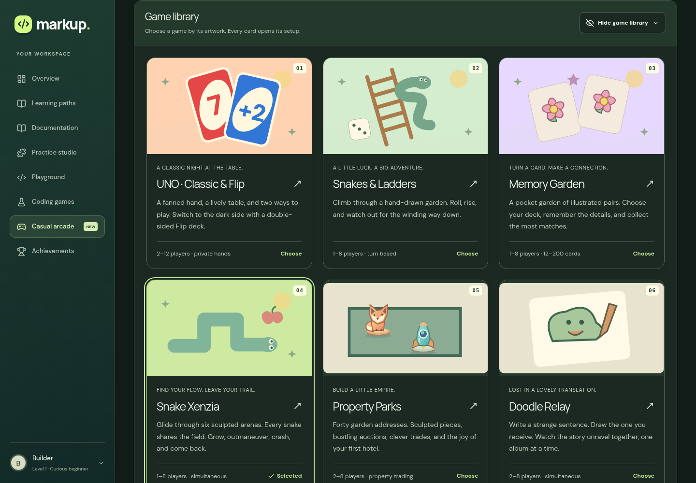
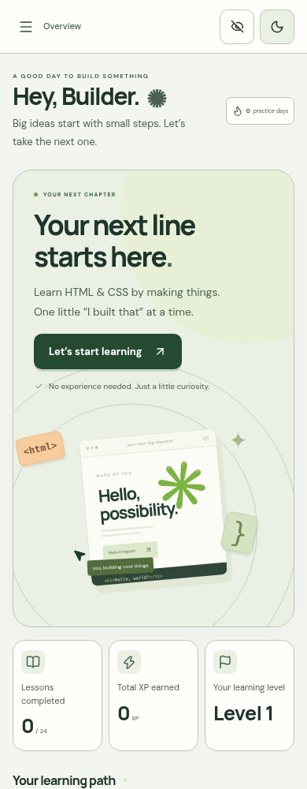
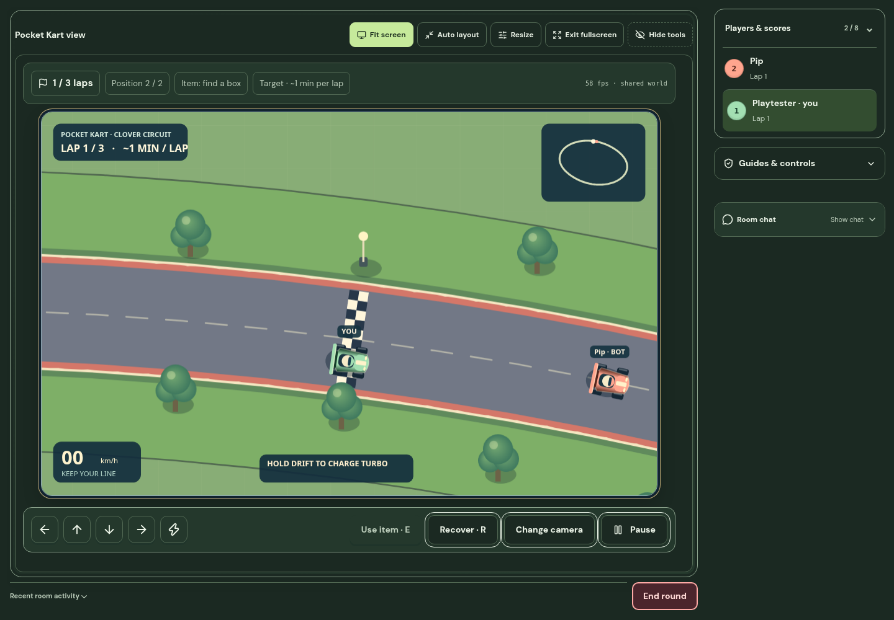
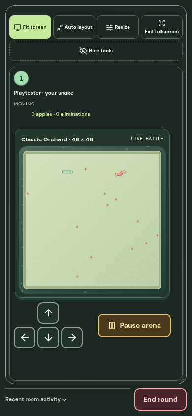
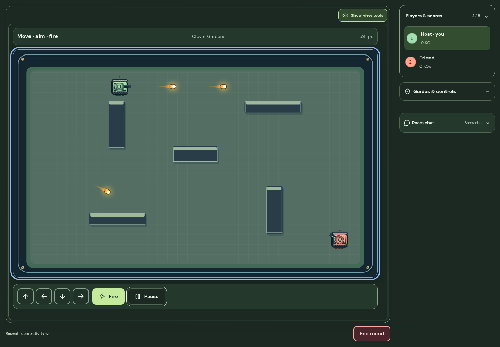

# Arcade redesign and control verification — v13

An outstanding kart item or recovery receipt previously held newer steering and key releases in the control queue. Kart commands already have independent sequence receipts on the server; the queue now allows fresh continuous input through its spare slot while retaining idempotent command retries. Terra's existing command ordering is preserved.

Fullscreen kart canvases could retain a small intrinsic bitmap width after the viewport grew. Fit mode now assigns an explicit display width and recalculates height after page scrolling. Snake uses a board-and-controls grid on wide views and compact controls on phones. Game status, view tools and end-round controls occupy their own space.

The site refresh adds larger artwork cards, legible descriptions, an unclipped game library, a stacked mobile homepage banner, revised panels and buttons, and richer UNO, memory and block colors. Navigation, library, settings and view tools have visible hide/show controls. Hiding navigation or view tools moves keyboard focus to the restore button.

Tank shells have a bright core, orange tail and halo, a shared 9-unit collision radius, and a slower 460-unit/s speed under the current arcade rules. Wall contacts handle the expanded shell footprint and show ricochet effects. Kart contacts now exchange an impulse and mark impacts; kart, sumo, marble and tank effects remain bounded and respect reduced-motion preferences.

## Validation

- TypeScript: passed.
- Unit and integration tests: **375 passed**, including five new regressions for control receipts, stale retries, shell footprints, wall ricochets and kart contact.
- Framework production build and GitHub Pages build: passed.
- Curriculum example syntax validation: 327 CSS documents parsed.
- Website: all eight sections at 1440, 390 and 320 pixels, plus map previews; 27 checks, no horizontal page overflow or page errors.
- Games: all 17 modes at desktop and phone sizes; 34 checks with live private room updates and no page errors or status/canvas overlaps. The five affected layouts were checked again after the final responsive changes, including fullscreen controls.
- Keyboard: eight live modes accepted real key input; continuous controls released to neutral and did not control the other human seat. A silently stalled Pong socket recovered.
- Hide/show tools: restored successfully at both sizes, in normal and fullscreen views, with keyboard focus retained and no horizontal overflow.
- Two browser contexts: the second tank player received movement, shells and neutral release; independent seats remained intact. The measured local receipt was 115 ms, which is not a production latency estimate.

These checks used real Chromium, the local frontend and the local Durable Object runtime. Remote production behavior and geographic latency were not verified. Publication in this task is through GitHub; no manual Cloudflare deployment was performed.

Terra's gameplay, terrain renderer and shared ActionWorld file match the pre-change SHA-256 values exactly. Hashes and condensed check results are in [arcade-v13.json](arcade-v13.json).

## Screenshots

