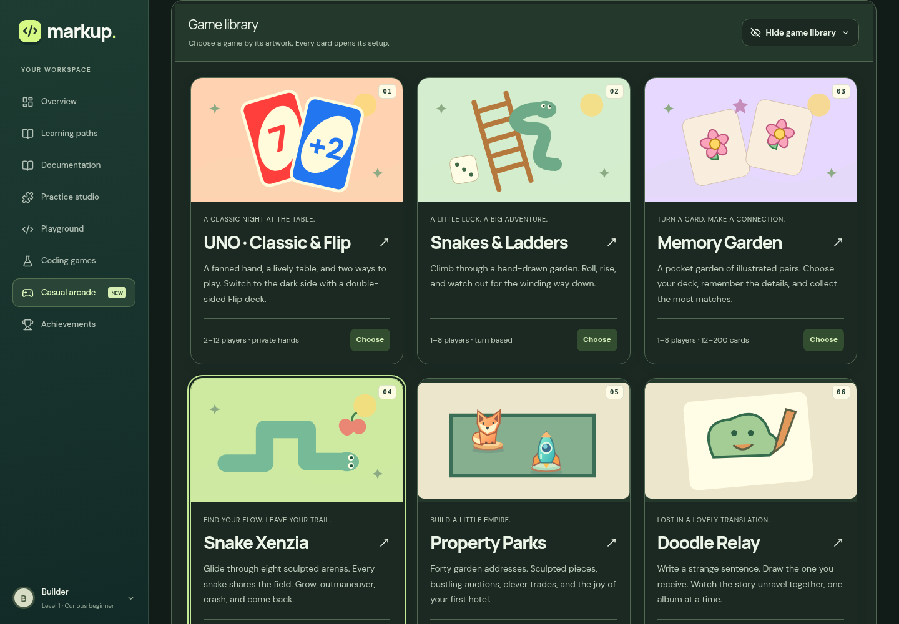
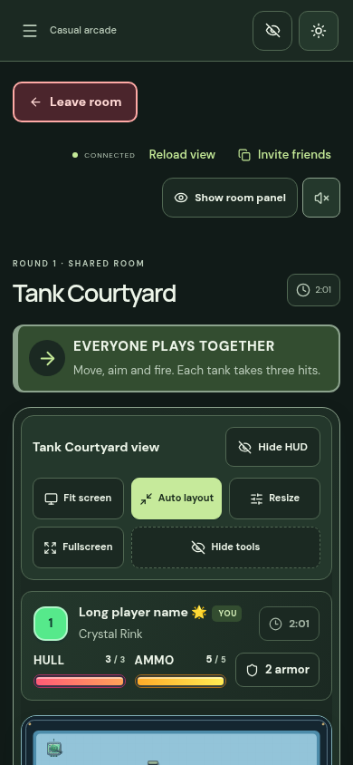
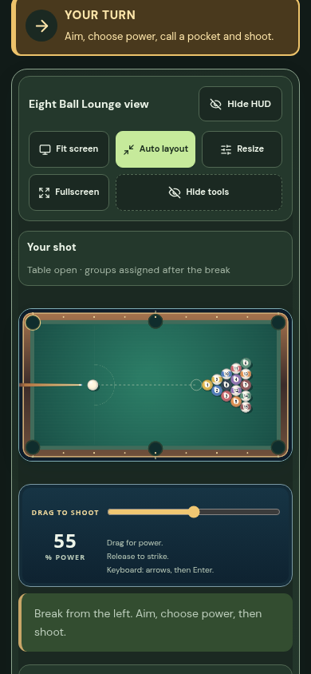
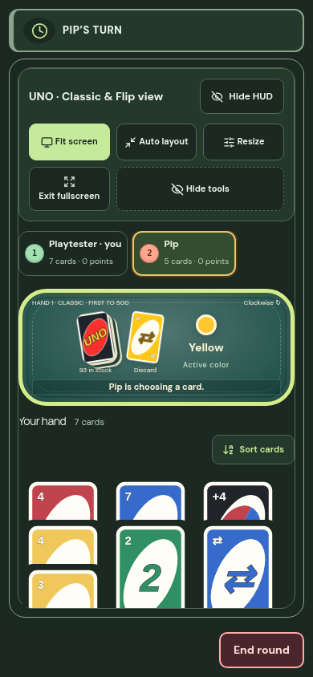

# Arcade v16: clear views, continuous Snake motion and active Sumo opponents

1 November 2026. Based on `b1804f42d8f0d825e6b5227d4242955ff690c695`, including the user's v14/v15 scene and transport work. This release adds no resources, storage migrations or changes to deployment configuration. Work in this session is published through GitHub; no manual Cloudflare or Sites deployment was performed.

## Visible changes

Non-Terraria games remove Recent room activity and its divider, Controls & tips, Guides & controls, and the Full content footer. Choose another game has a separate bordered button and returns the host to the lobby. Auto layout remains the default, with larger scenes, clearer player names and ranks, brighter player colors, labeled health/ammo/stamina bars, and more space around controls. Website navigation, room panels, view tools and HUD details each retain their own visible restore control. Hiding kart HUD also hides its canvas labels. Fullscreen UNO keeps Draw, Accept and Challenge outside the scrolling hand.

New content brings the totals to ten Snake maps, six action arenas, five kart tracks and six table scenes. Sunspire Courtyard and Coral Tidepools retain protected Snake starts and connected routes. Crystal Rink adds offset tank cover and a distinct marble course: enhanced marble matches have lower grip, stronger braking, and a signaled four-second crosswind every twenty seconds. Solar Speedway adds a continuous race route; a stuck bot uses the same last-checkpoint recovery as a human, without gaining checkpoint progress. Cobalt Royale and Cherry Arcade add table palettes.

New pool tables use **20-unit ball radii**, up from 16 in the preceding release and 10 in the original game. Rendering, rack spacing, aiming, collisions, pockets and placement use the stored radius. Existing tables retain their radius.

The frontend reads the room server's public content capabilities. A server without this metadata retains the preceding release's online choices; new choices remain available locally. An updated server advertises the new choices. This lets GitHub Pages update independently of the room Worker.

## Movement and matches

The supplied 13.9-second Snake recording was inspected frame by frame. The controlled snake's pauses and abrupt corrections informed the new presentation path. A visible head now follows known grid trails with bounded correction speed, and its body follows the path it actually traveled. Late straight snapshots do not pull it backward; turns follow corners instead of easing diagonally through walls. Respawns reset the presentation epoch. Authoritative collision cells remain unchanged. Body sampling walks the trail once, reuses output buffers, compresses straight segments and bounds retained corners.

Local turn scheduling now uses the display clock without counting transport delay twice. The previous release's autonomous simulation, adaptive acknowledgement window and pinned delta bases remain intact. A separate world-state watchdog refreshes over HTTPS if a responsive socket stops delivering simulation frames; control mutations continue to use the live channel. Timeouts account for measured multi-second RTT. Healthy autonomous streams continue to suppress redundant polling.

Sumo opponents use individual timing, flanking, stamina management and edge escapes, with the same abilities and collision rules as people. Twelve seeded eight-entrant regression tournaments finished all three rounds by ring-out without timeout tie-breaks, with varied champions. Sixteen additional simulations finished in 27.75–58.25 seconds. In a real browser match, the human deliberately left the ring; the remaining bot duel continued, the next round ran, one champion emerged, and Choose another game returned to the lobby. Client prediction still cannot decide shared tournament results.

## Measured delayed Snake rendering

Ordered WebSocket/HTTP proxy traffic adds half the configured RTT in each direction, with ±45 ms jitter per direction. The browser uses actual keyboard turns and traces the rendered controlled head during active play, excluding the starting countdown. A pause means consecutive active frames moving less than 0.001 grid cells. These are short local Chromium measurements, not geographic production latency measurements.

| Configured RTT | Render FPS | Largest state gap after 10 receipts | Largest rendered frame step | Longest active pause |
| --- | ---: | ---: | ---: | ---: |
| 400 ms | 58 | 456 ms | 0.344 cells | 0 ms |
| 3000 ms | 60 | 265 ms | 0.173 cells | 200 ms |
| 5000 ms | 60 | 306 ms | 0.344 cells | 0 ms |

The three-second profile still showed one 200 ms correction pause. Full-run state gaps, including startup, were 702, 1597 and 2571 ms respectively. These changes improve continuity; network transit still delays authoritative turns and outcomes. All three controlled snakes remained alive and produced no browser exceptions.

With world-state frames deliberately suppressed while the socket and pongs remained responsive, the first HTTPS recovery began after **890 ms**. Simulation ticks continued and normal streaming resumed. The healthy comparison made one initial HTTP GET.

## Verification

| Check | Result |
| --- | --- |
| Complete unit/regression suite | **411 passed, 0 failed** |
| TypeScript, framework production build, GitHub Pages build | passed |
| Teaching CSS examples | 327 parsed successfully |
| Existing game layouts | 17 modes at 1440 and 390 px; no page exceptions or horizontal overflow |
| Final affected-layout recheck | Pool, UNO and Marble at both widths; phone fullscreen UNO actions visible |
| New content layouts | 34 desktop/phone views; correct scene, Auto default, no overlapping buttons, removed help/activity/footer absent |
| Website | 27 section/card checks at 1440, 390 and 320 px; no exceptions or horizontal overflow |
| Independent view controls | normal/fullscreen at desktop and phone; visible restores, canvas remains usable |
| Real keyboard inputs | Snake, Sumo, Tanks, Pong, Marble, Blocks, Kart and Terraria; acknowledged movement, releases where applicable, other human untouched |
| Lost incoming socket frames | Pong reconnected automatically |
| Server capability compatibility | older server retains baseline online choices and new local track; updated server creates and starts the new online track |
| New geometry | all map connectivity/start checks, all five kart tracks with bots, new arena starts, bounded wind/prediction checks passed |

The first layout run found a fullscreen phone UNO Draw action below the hand. The final CSS reserves space for decisions, scrolls the hand, and the affected-layout rerun passed. Optional scene effects remain bounded and respect reduced motion; static geometry and sprites retain their caches.

Terraria's game source, terrain renderer, shared ActionWorld and LegacyGameSurface are unchanged from the latest user baseline. SHA-256 checks:

```text
054b3e029fb2f2c225d52af986ea7f39ca510639a4c3277471371ce53cdd15ba  lib/casual/terra.ts
1d8942126ae96546d5bb7764e25fdabb1817610f7a16ec39f41b54ca136d41db  components/casual/terra-terrain.ts
fc0da2da8bd41bfe11cd36bd59b32410256ea1e8852b4a097b9c449b7b8dec22  components/casual/ActionWorld.tsx
```

[Condensed measurements and checks](arcade-v16/results.json). Tests use local Chromium and Wrangler's Durable Object runtime, with a local-only 22 May compatibility override required by the installed runtime. Production compatibility remains unchanged. Physical phones, Safari/Firefox and real packet loss were not measured.








