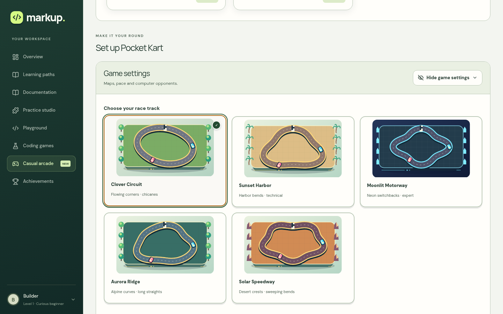
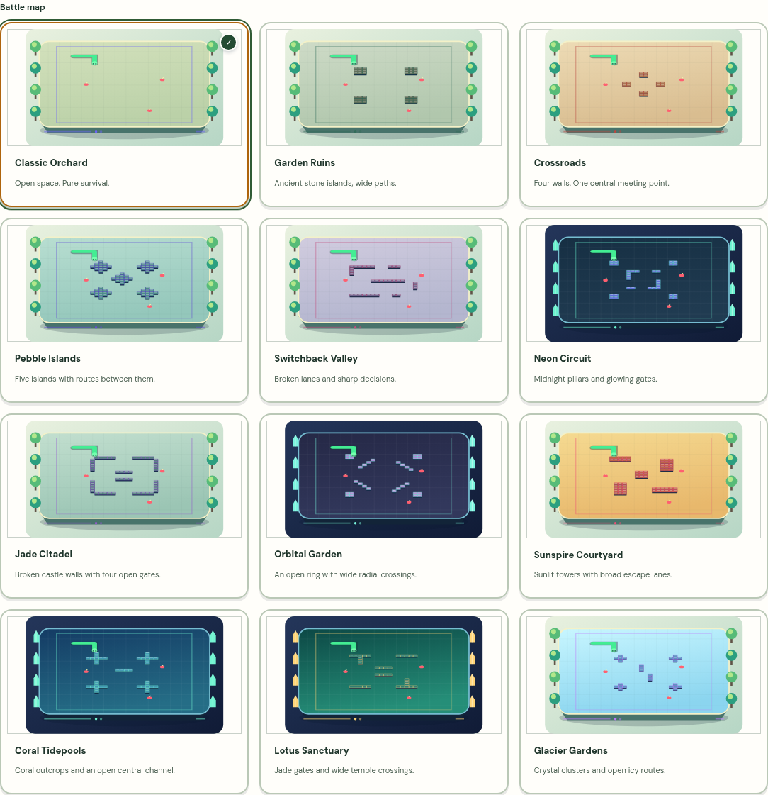
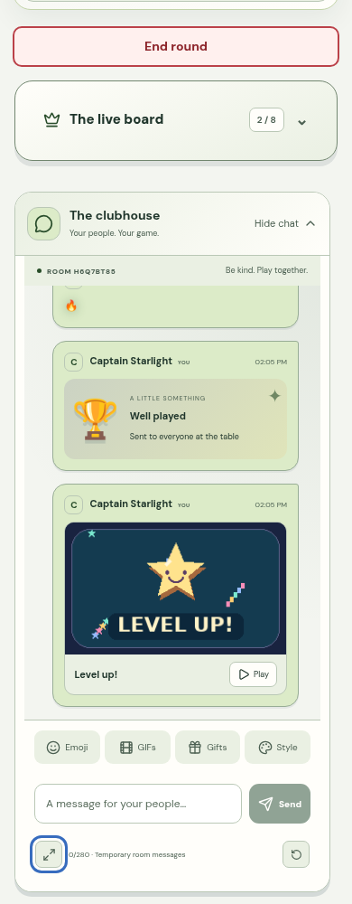
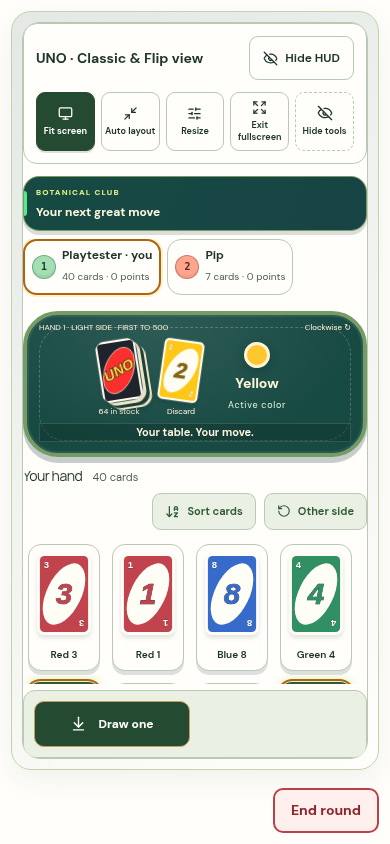
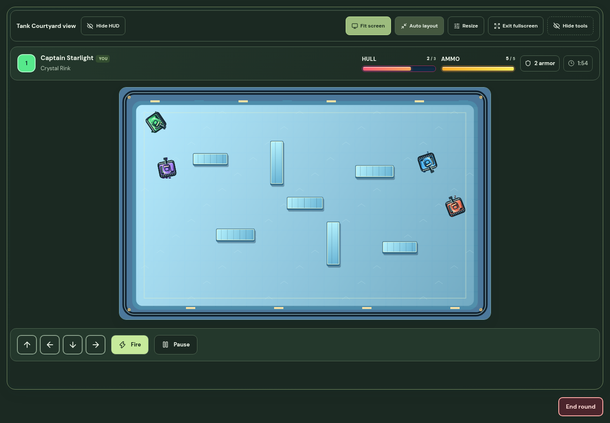

# Arcade v17: paced opponents and an illustrated clubhouse

1 November 2026. Based on `df678b666f6edf5763013496c3aec5adc2d311ca`. The previous release's continuous state stream, Snake reconciliation, Sumo bracket rules and stored pool-ball sizes remain intact. This session publishes through GitHub. It does not manually deploy Cloudflare or Sites, change storage namespaces or introduce migrations.

## Opponents take time to decide

Memory, UNO, Chess, Dama, Sci-Dama, Pool, Snakes & Ladders and Property now start a **fresh 1000–2800 ms thinking interval for each decision**. The preceding room-wide timer could already be expired when a human finished, allowing an immediate response. The new clock is keyed to the actor and decision, survives repeated reads, and does not reset when another message arrives. Memory waits separately for both flips and after keeping a matched-pair turn. UNO waits again after drawing or choosing an opening color. Pool starts thinking after motion settles and waits again before repeat shots.

The room server owns the clock; local games use the same rules. A small public thinking notice identifies the current bot and its deadline. Random seeds, profiles, remembered cards and planned actions remain private. Human controls remain with the human seat.

Bots have stable personalities within each match: tactician, attacker, explorer or guardian. Memory recall remains limited, fallible and based on observed faces. UNO considers its own hand, public opponent card counts, color control and attack cards; it does not read unseen opponent faces or private challenge evidence. Chess and Dama examine at most eight candidate positions and legal replies to reduce exposed-piece moves, promote, develop and defend. Sci-Dama retains its signed consumption objective. Pool varies target preference, shot accuracy and power while using the same collision and placement rules as people. All randomness uses the private bot stream rather than changing human dice or deck randomness.

Live Chromium rooms verified all six requested games. Measurements below run from the first delivered thinking notice to the first delivered changed game state; the notice itself arrives after the thinking clock has started. The committed deadline was respected in every case. Notifications add about 100 ms after the decision.

| Game | Visible decision after thinking notice | Delivered state after committed deadline |
| --- | ---: | ---: |
| Chess | 2324 ms | 116 ms |
| Dama | 2558 ms | 104 ms |
| Sci-Dama | 1338 ms | 102 ms |
| Memory | 2187 ms | 102 ms |
| UNO | 1437 ms | 103 ms |
| Pool | 2257 ms | 102 ms |

Memory's second flip had its own verified delay. Unit coverage additionally checks an actual human Chess move after the old timer expired, no early decisions under repeated polling, variable delays, legal tactical variation, and hidden-card independence. Normal reveal and movement animations retain their own time; network transit can add more time before a player sees an authoritative decision.

## Visual direction and maps

The direction is a bright illustrated arcade: raised map dioramas, clear silhouettes, dimensional materials, saturated player colors, readable turn strips and compact player badges. Original vector and canvas artwork is used throughout this update.

Research references:

- [SuperTuxKart race HUD](https://github.com/supertuxkart/stk-code/blob/master/src/states_screens/race_gui.cpp): edge-anchored information, resolution-aware scaling and space for touch input informed the compact HUD and route previews.
- [Chessground renderer](https://github.com/lichess-org/chessground/blob/master/src/render.ts): stable piece identity and careful animation reuse reinforced preserving the existing board movement model while changing materials and presentation.
- [Unciv](https://github.com/yairm210/Unciv), including its public preview image: strong terrain distinctions, readable outlines and grouped turn information informed the map palettes. Its dense interface was not reproduced.

No external game's artwork, logos or source code was copied into the new assets.

Snake map cards now depict their registry geometry, raised obstacles, the controlled snake and distinct terrain palettes. **Lotus Sanctuary** and **Glacier Gardens** bring the total to **12 maps**. Protected starts and connected routes are covered by the existing geometry checks. The playable scene has distinct water, crystal, temple, night and garden treatments, with wall bevels and edge highlights drawn from the authoritative obstacle cells.

Tank previews show the actual cover layout and dimensional vehicles. The six arenas gain clearer floors, raised cover, material seams, border lighting and industrial markings. Kart previews show five distinct real routes. The race renderer adds repeated terrain textures, coastal water, alpine trees and desert rock forms, with new cached kart body, cockpit and helmet artwork. Tank turrets, Pong paddles and marbles also use cached shaded models. Physics footprints remain unchanged.

**Lagoon Palace** and **Starlight Carnival** bring board and table themes to **eight**. Snakes & Ladders gets a themed tile field, route colors, marked climbs/slides and a finish crown. Chess and Dama gain stronger ivory/cobalt silhouettes and board materials. Memory has richer card backs and matched ownership, UNO has a clearer table and hand, and the remaining table games share the new palette and control treatment. Board/table HUDs show turn status and relevant game counts. The three coding games receive matching stat chips, progress and live-score styling.

The leaderboard adds portrait badges, rank, leader crowns, presence indicators, current-turn treatment and bot thinking notices. Names wrap, and emoji initials preserve complete characters. Auto layout and the existing independent interface, room-panel, HUD and view-tool restore controls remain available.

## Chat that fits the room

The clubhouse chat supports pointer and keyboard resizing in both dimensions. Wider chat expands the desktop room panel; phone chat stays inside the viewport. It includes 28 emoji shortcuts, the six existing free gift stickers, three original built-in GIFs, four text styles, and safe bold/italic/code formatting. Text remains React-rendered text; no message HTML is evaluated. Emoji insertion preserves whole joined characters within the 280-unit server limit.

GIFs load from this site, with static posters by default. Only one GIF can play in a chat at once. Closing or hiding chat, leaving the viewport, backgrounding the page or enabling reduced motion stops playback. No GIF provider API, tracking image, external font or third-party media request is required. GIF identifiers, rather than animation bytes, travel through the existing authenticated chat channel. The three animation files total about **47 KB** and each is below 25 KB.

Two real players verified styled text, emoji, gifts and GIF delivery at desktop and phone sizes. The chat expanded from 312 to 412 px on desktop and its message area grew from 360 to 480 px using pointer and keyboard controls. There was no horizontal overflow, no game input from chat resizing, and **zero chat DOM mutations during an unchanged live-world sample**. Reduced-motion playback and literal HTML-looking text were checked.

## Performance and compatibility

- Model materials, tank backdrops and race terrain tiles are cached. Tank backdrops retain at most three images; race terrain uses 96 px tiles instead of a large world bitmap. Snake scenery is rasterized once per map/size.
- Snake preview walls use three batched SVG paths per map, avoiding a separate group of elements for every obstacle cell. Detailed map previews are memoized.
- Idle tables wake at most once per second between relevant deadlines, while moving Pool and the existing real-time games retain 50 ms simulation steps. A newly committed move can bring a pending wake forward, so an idle table does not add a second of latency before starting its bot clock. Foreground authentication, heartbeat presence, storage authority and the bounded stream acknowledgement window remain intact.
- Non-Terraria local loops stop outside active play, and visible clock updates skip hidden or idle views. Unchanged chat does not render on every incoming world snapshot.
- Content capabilities are reused when a new room uses the same origin. Checks tolerate a five-second response. An older server retains its supported online choices; all new themes remain available for local play until the room server advertises them.

Six final renderer samples used four participants at desktop and phone widths. They recorded **55–60 FPS**. Warm tank and kart samples created no canvas gradients during the 1.8-second measurement window. Marble retained dynamic material work and stayed at 60 FPS. These measurements describe local rendering, not every device's frame budget.

The refreshed Snake scene was measured again through an ordered HTTP/WebSocket delay proxy with ±45 ms jitter per direction. Traces record the rendered controlled head during active play, excluding countdown frames.

| Configured RTT | Render FPS | Largest state gap after 10 receipts | Longest active pause |
| --- | ---: | ---: | ---: |
| 400 ms | 60 | 405 ms | 0 ms |
| 3000 ms | 60 | 297 ms | 133 ms |
| 5000 ms | 60 | 291 ms | 0 ms |

All three snakes remained alive and no browser exceptions occurred. Full-run state gaps including startup were 552, 1611 and 2603 ms. The three-second profile still had one short correction pause; transit latency is not removed. Suppressing world frames while retaining a responsive socket triggered HTTPS recovery after **925 ms**, with simulation continuing and streaming resuming.

## Verification and preservation

- **425 tests**, TypeScript, framework production build and GitHub Pages build passed; 327 teaching CSS examples parsed.
- 17 casual modes were checked at 1440 and 390 px. An initial phone fullscreen UNO issue was corrected by budgeting the HUD separately and using content-sized hand rows. The final 40-card hand, color choice and penalty fixtures had no overlapping cards or hidden decision buttons.
- 42 new-content layouts, 27 website/card checks, six coding-game views, eight actual keyboard/release/reconnect checks, six live bot flows and two two-player chat flows passed.
- The five kart previews have distinct route paths at desktop, phone and 320 px widths. Older-server, current-server and delayed-capability cases each made one capability request and preserved online/local availability correctly.
- The protected Terraria game, terrain renderer, ActionWorld and LegacyGameSurface are unchanged. Its chat uses an exact copy of the preceding component. Terraria keeps its previous gameplay and UI rather than adopting these new surfaces.

```text
054b3e029fb2f2c225d52af986ea7f39ca510639a4c3277471371ce53cdd15ba  lib/casual/terra.ts
1d8942126ae96546d5bb7764e25fdabb1817610f7a16ec39f41b54ca136d41db  components/casual/terra-terrain.ts
fc0da2da8bd41bfe11cd36bd59b32410256ea1e8852b4a097b9c449b7b8dec22  components/casual/ActionWorld.tsx
9427c2c7d5b811a2b565e0823a6eb7d2c2635d4a3741be43e4122a7a266dd870  previous GameChat / preserved LegacyGameChat
```

[Measurements and checks](arcade-v17/results.json). Browser measurements use local Chromium and the local Durable Object runtime. The production compatibility date and bindings are unchanged; the installed local runtime uses the same May compatibility override as the preceding release. Physical devices, Safari/Firefox and geographically separated players were not measured. Server-side bot pacing and new chat metadata require the later room Worker deployment; the GitHub-only session does not claim that deployment has occurred.










