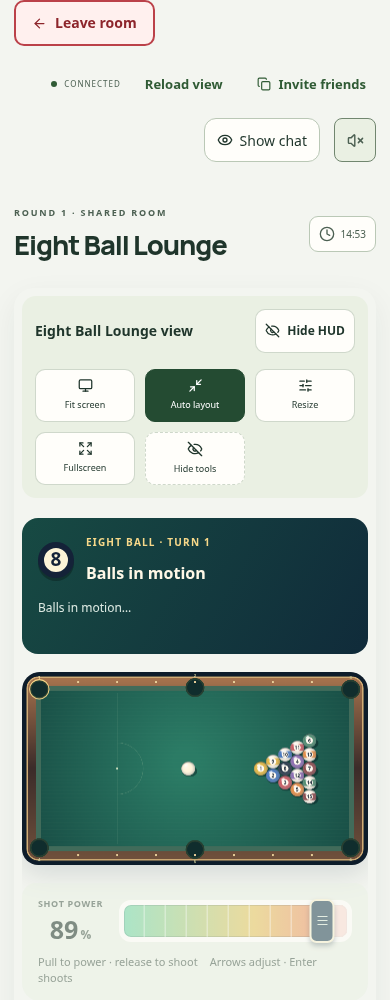
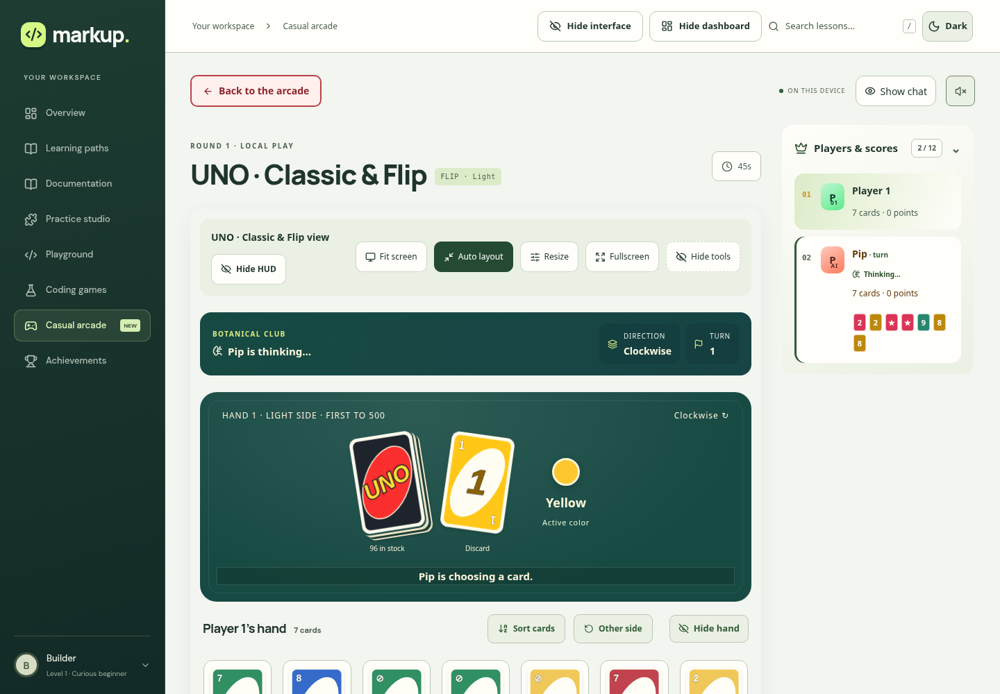

# Recording fixes and a cleaner arcade

1 November 2026. GitHub was fetched before implementation and the two newer merged updates, PRs #3 and #4, were incorporated through `c2de80c`. Both supplied recordings were reviewed before changing the games: the 20.73-second Snake recording and the 26.57-second pool reference. The [Snake reference](https://github.com/snakejs/snakejs.github.io) was inspected at `8c3c2438f609fb13c1d71246569a98162c1ec481` for its separation of grid updates and animation. The existing shared room authority remains responsible for gameplay.

## Snake movement and controls

The renderer previously rebuilt long bodies from a wire trail capped at 32 points. Longer tails could collapse onto the last recorded point. The complete authoritative body now extends that trail. Rendering follows a continuous ribbon with the actual corner vertices and consistent traveled length, rather than drawing diagonals between interpolated segment centers. The large focus ring that protruded beyond the head's cell is removed, and the head fits its cell.

Late-route recovery no longer crawls backwards through the snake's own body. A genuinely different confirmed route uses a short fade. Normal matching routes keep continuous movement. Respawns and round changes retain their separate presentation epochs.

Turn scheduling accounts for both the incoming snapshot and the outgoing input. Links at or above 120 ms RTT reserve one extra grid step for delivery variation; queued turns receive immediate visible feedback. This fixes the observed missed-boundary corrections without changing server collision rules or accepting client positions.

Three two-browser matches exercised **18 consecutive turns** at 400 ms RTT with ±80 ms jitter. They recorded zero reverse corrections and a largest displayed step of **0.172 cells**. An earlier run exposed corrections of about 1.25 cells before the delivery margin was corrected. [Final turn traces](arcade-v18/snake-turns.json).

Snake bots now evaluate reachable food, bounded escape space, tail access and opposing head approaches. Search visits at most 1024 cells per candidate. Decisions occur once per grid tick, with a fresh decision after a resumed simulation epoch. The private bot random stream remains separate from food and game randomness.

## Layout, scoreboards and pool

Scores have one dedicated side panel on wide screens and a collapsible panel on phones. Chat toggles independently. Repeated player strips are removed from the play surfaces; public UNO Flip reverse faces remain available in the side panel. Tank status keeps its additional battle display, with larger segmented hull bars on the arena and readable hull, armor and ammunition in the player panel. Pong's scores live in the player panel.

Nested outer frames and colliding selected outlines are replaced with a single scene boundary and inset selection marks. The website and arcade use clearer type sizes, stronger headings, consistent button targets and more space between controls. UNO hand titles, card counts and hand tools have separate room. Pool's aim and called-pocket fields have usable widths on phones. The Playground's file tabs now determine their own height, preventing the editing textarea from covering them. Recent room activity is removed from both casual and coding rooms; game events still support gameplay internally.

Pool has a compact match HUD, visible remaining-ball badges and a large green-to-red power control. Desktop uses a vertical pull control; phones use a horizontal control below the table. Dragging and releasing shoots. Tapping sets power, cancellation does not shoot, and arrows plus Enter work from the keyboard. The status area reserves message space so ordinary shot messages do not move the table. The low-power curve allows gentler shots while retaining the 800-unit maximum speed. Shared authoritative physics still handles collisions and impacts.

Pool bots use clear ghost-ball approaches, object-to-pocket paths, one-rail alternatives, scratch-risk penalties and power estimated from the game's rolling deceleration. They find legal cue placements instead of repeatedly choosing an occupied fixed point. Existing paced board-game personalities and the latest maps, models and chat updates from GitHub are retained.

## Client work and network evidence

The live feed supplies the measured frame byte count to the transport. The browser no longer serializes a decoded world again just to count its bytes. A local benchmark of 600 eight-Snake full-state messages, including JSON parsing and UTF-8 accounting, measured a median **165.12 ms before and 107.87 ms after** across five alternating runs—about **35% less CPU time** in that fixture. This measures client processing, not Internet RTT. [Pipeline benchmark](arcade-v18/client-pipeline.json).

Hidden room chat loads when opened. The browser checks observed zero chat-module requests before opening it and two after. Selected game scenes retain their existing warming and caching. The compatibility pack preserves **194 immutable client assets**, including the published Site versions 13 and 14 and their retained dependencies, so open tabs can continue loading their lazy modules.

The existing adaptive state windows, compact authenticated movement receipts, private projections and HTTP recovery remain active. New local ordered-transport checks measured:

| Profile | Window | Largest state gap | Median control receipt |
| --- | ---: | ---: | ---: |
| 3000 ms RTT, ±80 ms jitter, old window | 4 | 2863 ms | 3048 ms |
| 3000 ms RTT, ±80 ms jitter, adaptive | 33 | 239 ms | 3025 ms |
| 5000 ms RTT, ±80 ms jitter, adaptive | 53 | 261 ms | 5055 ms |

A real two-Chromium tank match at 3000 ms RTT received 70 states, applied all controls, recorded no reverse movement while held, and had a 3049 ms median control receipt. An eight-human-seat local check delivered ten states to every seat in 1.062 seconds, around 14.2 KB/s per seat, with a 9 ms median receipt. These checks establish continuous delivery and correct input handling in the tested conditions. They do not remove network transit time or establish geographic production capacity.

## Validation

| Check | Result |
| --- | --- |
| TypeScript and full test suite | **435 passed**, 0 failed |
| Casual game layouts | all 17 modes, desktop and phone; 34 passed |
| Game control groups | 34 mode/size cases; no overlapping interactive controls in the checked toolbars and action groups |
| Website spacing | 8 sections × 1440, 390 and 320 px; 24 passed, no overlapping visible controls or horizontal overflow |
| Dark scenes and map choices | 9 modes × desktop and phone; 18 passed |
| Coding games | all 3 timed modes × desktop and phone; 6 passed |
| View controls | website visibility, independent chat, retained scoreboard, HUD, tools, focus, Fit and fullscreen restoration; 2 passed |
| Pool controls | drag, cancel and keyboard × desktop and phone; 6 passed; aim/pocket fields exceed 100 px |
| UNO decisions | 40-card Flip hands and fullscreen Wild choices × desktop and phone; 4 passed |
| Drawing and Sumo | exact stroke undo/redo and PNG export; a winning wrestler watches a live duel; 4 passed |
| Bot autonomy | UNO bot advanced through live states with no HTTP polls during the wait |
| Multiplayer | eight humans, isolated private hands, input release, bounded slow-receiver queues and future-ACK rejection |
| Other motion | kart, tank, marble, Sumo and blocks at 400 ms RTT; no reverse frames while held |
| HTTP fallback | two tank clients with WebSockets disabled; eight HTTP controls applied with no reverse correction |
| Terraria preservation | game, terrain, shared ActionWorld and original viewport sources match `c2de80c` byte for byte |

Release builds cover the hosted Site, static Pages output and dedicated Worker bundle. Publication keeps the existing public Site and existing D1 and Durable Object IDs. The dedicated API bundle is uploaded only to `markup-arcade`; the separate full-site target remains under its repository deployment workflow.

Evidence: [game layouts](arcade-v18/game-layouts.json), [control spacing](arcade-v18/control-spacing.json), [website](arcade-v18/website-spacing.json), [scenes](arcade-v18/scenes.json), [view controls](arcade-v18/view-controls.json), [pool](arcade-v18/pool-controls.json), [UNO](arcade-v18/uno-decisions.json), [drawing/Sumo](arcade-v18/drawing-and-sumo.json), [coding](arcade-v18/coding-layouts.json), [socket checks](arcade-v18/sockets.json), [slow transport](arcade-v18/slow-network.json), [slow browser](arcade-v18/slow-browser.json), [other movement](arcade-v18/other-movement.json), [HTTP fallback](arcade-v18/http-fallback.json), [autonomous UNO](arcade-v18/autonomous-uno.json), [Terraria hashes](arcade-v18/preserved-terra.json).

Interactive checks used local Chromium and Wrangler's local room runtime. Phone dimensions are browser emulation; physical phones, other browsers, real packet loss and geographically separated production matches were not measured. Production compatibility stays at 31 October 2026; the installed local runtime requires a 22 May override.
