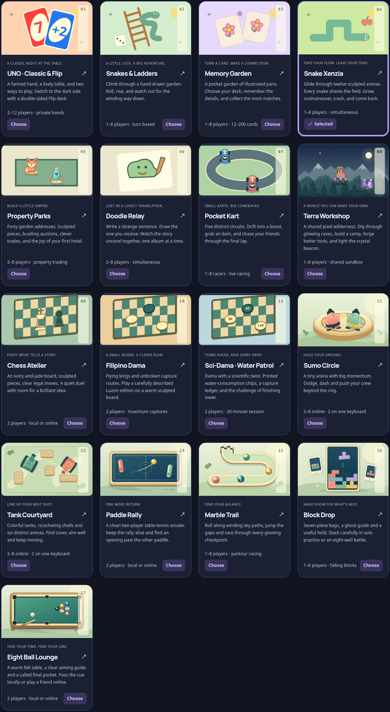
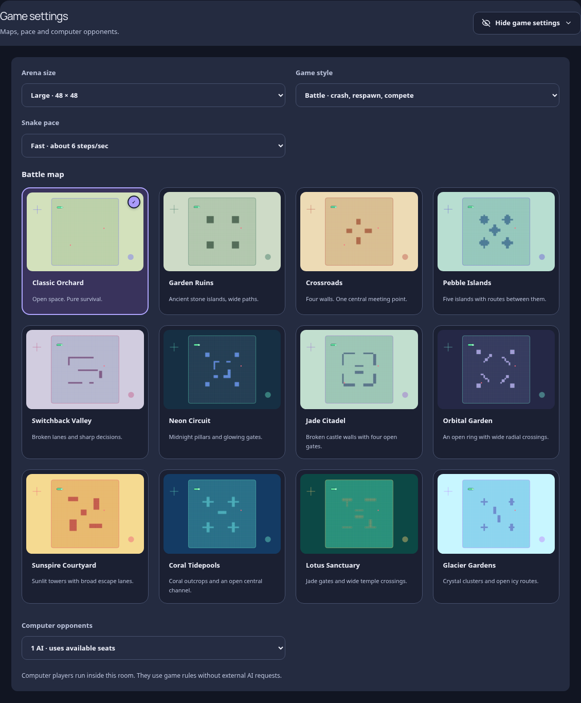
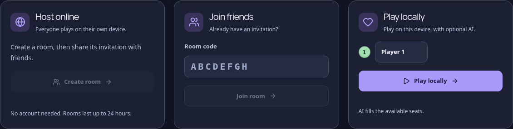

# Arcade v19: illustrated library, flexible rooms and collision geometry

The source baseline was GitHub main at `cf6e69ce7813aaff5c8e08942bfa1b7827168620`, matching published Site version 15. All nine supplied screenshots were reviewed. The changes cover the requested game library, map choices, room setup, colors, turn feedback, panel placement, collision boundaries and performance.

## Resumed GitHub work and Snake recording

On 2 November 2026, GitHub main had advanced to `26c53db668d8a97b3afa7db69e3351b742db5841` (PR #5). Those changes are merged, including confirmed remote Snake playback, corner preservation, visible authority corrections, countdown timing, transport recovery, idle canvas suspension, server caching and the new CI workflow. Collision/render conflicts retain both the shared physical hulls and the newer ability indicators, tread motion and expired-projectile checks.

The supplied 43-second recording shows Garden Ruins at 48×48 with repeated turns and correction fading. The merged code removed fading, but a fresh 32-turn replay at the fastest 125 ms step exposed a separate fast-link defect: inputs could redirect a cell already partly drawn. Turn scheduling now reserves the next untouched boundary on local and low-latency connections as well as slow ones. A regression exercises five speeds, six RTT values and five input phases (150 cases), checking that the drawn path remains unchanged at input and the turn still executes.

The fast-connection replay's maximum displayed step fell from 0.706 to 0.150 cells, with no steps above 0.65 cells, no fading and 60 FPS. The 400/900 ms RTT runs with ±80 ms jitter also kept presentation fully visible. One 400 ms run required a 1.326-cell authority correction; its diagnostic repeat had none. This is recorded rather than presenting delayed prediction as infallible. Death/respawn transitions are counted separately. [Recording replay evidence](arcade-v19/snake-recording.json). The existing [GitHub reliability report](performance-v19.md) covers its earlier independent checks.

## Interface and choices

The original illustrated game-card artwork is restored, with a compact four-column desktop library. The selected-game thumbnail is bounded to 88 × 52 pixels. Only map/table selection artwork is redesigned: 89 static SVG images are generated from the shared maps, track paths, cover geometry and table palettes. They load as lazy images instead of large inline SVG trees. Snake previews reflect all three arena sizes. Selected cards use an inset border and a check mark.

Slate surfaces and indigo controls replace the green website palette in both themes. The implementation uses separate default, hover, pressed, selected and focus states, guided by [Radix's scale usage](https://www.radix-ui.com/colors/docs/palette-composition/understanding-the-scale) and [palette composition](https://www.radix-ui.com/colors/docs/palette-composition/composing-a-palette). These sources distinguish neutral surfaces, interaction backgrounds, borders and readable text. [Carbon's interaction-state specifications](https://www.carbondesignsystem.com/building-blocks/core/components/select/specifications) informed explicit selected and focus feedback. Game artwork and player identity colors retain their own palettes.

Room setup has separate Host online, Join friends and Play locally cards, a shared display-name field, readable room codes and clear action labels. Local arena games expose the two-human option. Generic repeated turn/game descriptions, including the Block Drop strip, are removed. Game-specific controls, rules and live status remain available.

The stale client capability fallback no longer disables valid maps or themes. The current catalog is used consistently, and room creation does not wait for a separate health request. The server still validates selections. A real local Worker test created human seats, configured and started **145 catalog combinations** online and with the local engine: 36 Snake map/size combinations, 24 PvP arenas, five tracks and 80 table choices. No choice was silently substituted. [Catalog results](arcade-v19/catalog.json).

## Game space, players and chat

Live rooms remove both parent width caps. At a 2560-pixel viewport, the room occupies 2242 pixels; the initial game column occupies 1922 pixels beside the 300-pixel panels. The game starts directly after the website navigation and content padding.

Players/scores and chat open automatically on the right on wide screens and stack below the game on phones. Each panel owns its Hide/Show control, position selector, width/height controls and pointer/keyboard resize grip. Both can move left, right, above or below the game. The grid reserves only occupied columns and stacks when the remaining game area would be too narrow. Moving or hiding a panel preserves the chat draft. Preferences retain panel positions and sizes; new rooms show both panels.

The Botanical Club scene label and emblem are retained. The emblem uses the actual active player's color. Your available turn has a neon border and glow; another player's turn uses their color without that glow. Ten presentation cases cover the eight turn-based games plus Doodle Relay and Block Drop. The simultaneous games use your task/well state rather than a host turn. Pool shares this scene HUD and keeps its shot feedback separately. [Ownership/color results](arcade-v19/turn-colors.json).

## Visible collision footprints

Kart wheels/bumpers and tank treads now use oriented chassis hulls. Hull dimensions are shared with the renderers. Car/car and tank/cover contacts use separating axes; shells test the tank's oriented hull. Racing barriers and boats use their rectangular geometry. Marble dimensions remain spherical, and the Sumo model is scaled to its existing body-contact radius without changing its duel rules.

The same simulation functions run on the room authority and client prediction. Broad phases skip distant bodies and cover. Cached immutable segment indexes replace exhaustive road scans in ordinary play. Off-track queries retain an exact fallback. Road-edge correction is followed by bounded contact resolution toward the lane, so a shoulder cannot force the wheels back into scenery. The regression checks every scenery object and barrier at four chassis angles on all five tracks, along with rotated treads, safe eight-seat spawns, projectile contacts and public-state prediction versus room advancement.

Terraria's gameplay, terrain renderer and original surface implementation are unchanged. The general room panels and website palette apply around it.

## Measured work

Measurements below are local fixtures, not geographic production latency or capacity claims.

| Fixture | Before | After |
| --- | ---: | ---: |
| Initial arcade DOM elements | 2162 | 995 |
| Descendants per Snake map card | 63–71 | 3 |
| Roster renders during 3 seconds of unchanged standings, 20 Hz arena updates | 55 | 0 |
| 1200 eight-player racing steps, median | 49.21 ms | 31.05 ms |
| 1200 eight-player tank steps, median | 43.21 ms | 30.36 ms |
| 1200 eight-player marble steps, median | 23.01 ms | 20.51 ms |

The arcade DOM is about **54% smaller**. The simulation fixture measured about **37% less racing CPU time**, **30% less tank CPU time** and **11% less marble CPU time**. Sumo was effectively unchanged. Before integrating PR #5, the simulation benchmark alternated the source baseline and the collision/geometry implementation in one Node process, used four warm-up passes and 20 measured samples per implementation, and ran after browser and server teardown. Each fixture used eight human actors with the same seeded initial settings and control stream. The roster comparison instruments the same component with its comparator enabled and disabled. [Simulation measurements](arcade-v19/simulation-benchmark.json), [roster measurements](arcade-v19/roster-benchmark.json), [DOM before](arcade-v19/dom-before.json), [DOM after](arcade-v19/dom-after.json).

HTTP fallback prediction now budgets both network legs and the polling gap, while preserving the 900 ms hard bound. A two-browser 400 ms RTT fallback match applied all eight control messages, recorded no reverse movement while held, responded visually in 7.9 ms and had a 149.9 ms largest displayed pause. The earlier fixture with the shorter allowance showed a 266.7 ms pause. Prediction does not remove transit time or make unconfirmed state authoritative. [HTTP results](arcade-v19/http-fallback.json).

Existing adaptive WebSocket windows, coalescing, private projections and input receipts remain active. The new ordered-proxy runs measured:

| Profile | State window | Largest state gap | Median control receipt |
| --- | ---: | ---: | ---: |
| 3000 ms RTT, ±80 ms jitter, baseline window | 4 | 2815 ms | 3049 ms |
| 3000 ms RTT, ±80 ms jitter, adaptive | 33 | 256 ms | 3049 ms |
| 5000 ms RTT, ±80 ms jitter, adaptive | 53 | 248 ms | 5103 ms |

A real two-Chromium 3000 ms RTT match received 73 states, applied all eight controls and recorded zero reverse frames. An eight-human-seat stream check delivered 11 states per seat in 1.234 seconds, around 12.8 KB/s per seat, with a 28 ms median action receipt. Invalid ACKs, a slow receiver, inactive/disconnected control release and private UNO projections passed. [Ordered transport](arcade-v19/slow-network.json), [browser transport](arcade-v19/browser-slow.json), [eight-seat results](arcade-v19/socket-load.json).

## Validation and publication

- TypeScript passes; **465 automated tests pass**.
- **34 game layouts** and **34 control-group checks** cover all 17 games at desktop and phone widths.
- **24 website checks** cover eight sections at 1440, 390 and 320 pixels without horizontal overflow or overlapping visible controls.
- **18 dark-scene checks**, **24 panel placements** at 2560/1440/390 pixels, **six pool drag/cancel/keyboard cases**, **ten HUD ownership cases** and **four theme/hover previews** pass.
- Both hosted and static builds regenerate the same map assets. The compatibility pack preserves 257 immutable client assets through Site v15 and their inherited dependencies.

[Layouts](arcade-v19/layouts.json), [controls](arcade-v19/controls.json), [website](arcade-v19/website.json), [dark scenes](arcade-v19/dark-scenes.json), [panels](arcade-v19/panels.json), [pool controls](arcade-v19/pool-controls.json), [hover previews](arcade-v19/previews.json).

The same final source is prepared for GitHub main, the existing public GPT Site and the dedicated `markup-arcade` room service. Durable Object namespace identities and the database are preserved. The separate full-site Cloudflare deployment is not replaced by an API-only bundle. Production access is verified through the native deployment tools; direct browser access to production hosts is outside this workspace's network policy. Physical phones, Safari/Firefox, geographic latency and packet loss are not established by these local Chromium/proxy checks.

