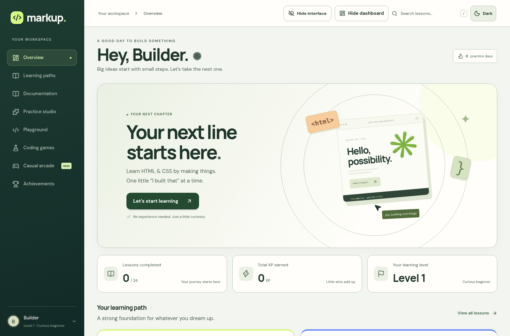
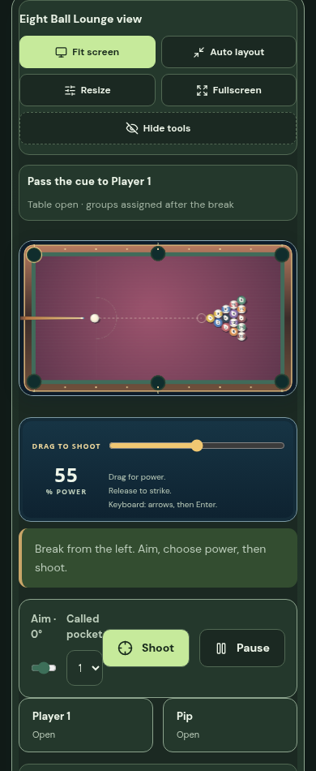

# Game studio, continuous state delivery and new scenes

1 November 2026. This update builds on published source `6cd5646`. It preserves the existing public Site, room database and Durable Object namespaces. Terraria's game, terrain renderer and shared ActionWorld source are byte-identical to that checkpoint; its viewport uses an exact copy of the previous implementation. [Preservation evidence](game-studio-v15/preserved-terra.json).

## What changed

The website has more generous typography, clearer game cards, stronger button contrast and responsive setup panels. Auto layout remains the default. Website navigation, room panels, viewport tools and game details have separate Hide/Show controls. Starting a casual match collapses the room panel. Explicit Fit screen scales the scene while controls remain in page flow; fullscreen restores the previous layout. Fitting observes dimensions rather than every state mutation. Keyboard activation of a guide cannot trigger a game action.

Four selectable table scenes—Botanical Club, Midnight Lounge, Sunset Terrace and Aurora Hall—give board and table games distinct palettes. UNO keeps straight readable cards, stronger hand controls and decisions outside its scrollable hand. Memory has clearer card backs and match feedback. Chess, Dama and Sci-Dama have stronger piece contrast and four board palettes without rule changes. Property has richer board and deed colors. Drawing Relay has 24 paint colors, coalesced pointer sampling and shared smooth stroke rendering for editing, received drawings and PNG export.

Snake has eight maps, including Jade Citadel and Orbital Garden, with protected starts and connected playable routes. Kart has four tracks, including Aurora Ridge. The shared action arenas have five maps, including Ember Foundry with offset cover. Enhanced tank matches on Foundry open supply pads for four seconds every twenty seconds of match time; each actor can refill five shells and restore one armor per cycle. Bots seek supplies when needed. Neon tank starts and respawns no longer intersect cover. Bright cached shell sprites distinguish incoming orange shells from the player's teal shells, with impact feedback and bounded effects. Sumo wrestlers have impact deformation, and client prediction cannot resolve tournament or classic-game results.

New pool tables use 16-unit balls, 60% larger than the original 10-unit balls; stored older tables keep their radius. Rack spacing, aim, contacts, rail handling, pockets, bot shots and placement share the actual radius. Block Drop uses larger rival wells for small matches, responsive canvas proportions, continuous falling-piece paint and bounded line-clear effects. Optional effects honor reduced motion.

## Why delayed rooms stopped updating in bursts

The fixed four-frame acknowledgement window emptied over multi-second round trips. The client now negotiates a bounded adaptive window (4–64), based on measured round-trip time. Older clients keep their four-frame behavior. State notifications run at 100 ms while action simulation retains 50 ms steps. Validated movement inputs can receive compact receipts instead of another complete private snapshot. Turn actions still receive full responses. Exact delta bases stay pinned until their pending request finishes, preventing a delayed response from referencing an evicted base.

Active casual rooms advance independently of browser polling, including bot turns and turn deadlines. Drawing Relay retains its HTTPS artwork path and revision notifications. Fresh autonomous streams suppress redundant polls. Diagnostics separately show actual world receipt age, update interval and round-trip latency; an input receipt does not reset the world-age display.

| Ordered transport profile | State window | Largest observed state gap | Median control receipt |
| --- | ---: | ---: | ---: |
| 3000 ms RTT, ±80 ms jitter, old window | 4 | 2860 ms | 3049 ms |
| 3000 ms RTT, ±80 ms jitter, adaptive | 33 | 243 ms | 3034 ms |
| 5000 ms RTT, ±80 ms jitter, adaptive | 53 | 253 ms | 5055 ms |

These are real ordered local WebSocket/HTTP proxy runs with two authenticated clients and committed controls. They demonstrate continuous state delivery after startup; they do not remove network transit time. A separate two-Chromium tank match at 3000 ms RTT recorded 70 states, no reverse corrections while held, a 216.7 ms maximum displayed pause and a 3069 ms median receipt. At 400 ms RTT, six movement modes passed with no reverse frames while a direction was held. Snake's first displayed movement was 149 ms in that run; grid turns remain subject to server delivery.

The eight-human-seat socket check delivered 11 state frames per seat in 1.11 seconds, with a 16 ms median local receipt and roughly 14.3 KB/s per seat. The preceding release's comparable local check used approximately 64–65 KB/s. This is measured integration traffic, not an Internet capacity guarantee.

## Validation

| Check | Result |
| --- | --- |
| TypeScript and complete test suite | passed; **400 tests**, 0 failed |
| Casual layouts | all 17 modes at 1440 and 390 px; correct selected mode, no page errors, overflow or HUD overlap |
| Website sections | 8 sections at 1440, 390 and 320 px; 24 passed |
| Selected table scenes and new maps | 9 modes at desktop and phone; 18 passed |
| View controls | website/panel/details/tools toggles, focus restoration, Fit and fullscreen; desktop and phone passed |
| UNO decisions | 40-card Flip hand scrolling and four Wild choices in fullscreen; 4 passed |
| Coding games | all 3 timed modes, Auto and Fit at desktop and phone; 6 passed |
| Drawing and Sumo | real pointer stroke, exact undo/redo, valid PNG export; winning player watches a live duel; 4 passed |
| Bot autonomy | UNO bot advanced through live states with zero HTTP polls during the wait |
| Multiplayer | 8 human sockets, private UNO projections, coalescing, future-ACK rejection, inactive/disconnected input release |
| Regression coverage | delayed exact-base response, bounded windows, authenticated compact receipts, all map starts/respawns, supply cycles and bot supply behavior |
| Simulation | existing seeded Sumo tournaments finish with one champion; all four kart tracks complete; all eight Snake maps retain open routes |
| Open-tab compatibility | 157 immutable JS/CSS assets retained with hashes and complete relative dependency graphs |

Release packaging runs the hosted build, static Pages build and dedicated Worker dry run from the pushed source commit. The existing public Site is published before replacing the dedicated `markup-arcade` bundle. Its three bindings retain their existing IDs, and no storage migration is introduced. The separate full-site Worker is not replaced with an API-only bundle.

## Evidence

- [Slow transport comparison](game-studio-v15/slow-network.json), [actual browser at 3000 ms RTT](game-studio-v15/browser-slow-network.json), [six-mode delayed movement](game-studio-v15/movement.json), [eight-seat sockets](game-studio-v15/sockets.json)
- [Game layouts](game-studio-v15/game-layouts.json), [website](game-studio-v15/website.json), [scenes](game-studio-v15/table-scenes.json), [view controls](game-studio-v15/view-controls.json), [coding layouts](game-studio-v15/coding-layouts.json)
- [UNO decisions](game-studio-v15/uno-decisions.json), [autonomous bot](game-studio-v15/autonomous-uno.json), [drawing and Sumo](game-studio-v15/drawing-and-sumo.json)

All interactive measurements used local Chromium and Wrangler's Durable Object runtime. Physical phones, Safari/Firefox, real packet loss and matches between geographically separated players were not measured. Production compatibility remains 31 October 2026; the installed local runtime requires a 22 May override. Multi-second Internet latency still delays authoritative outcomes.
