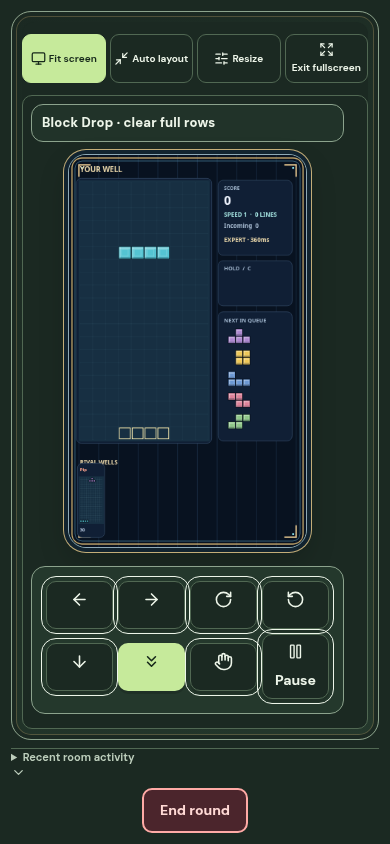
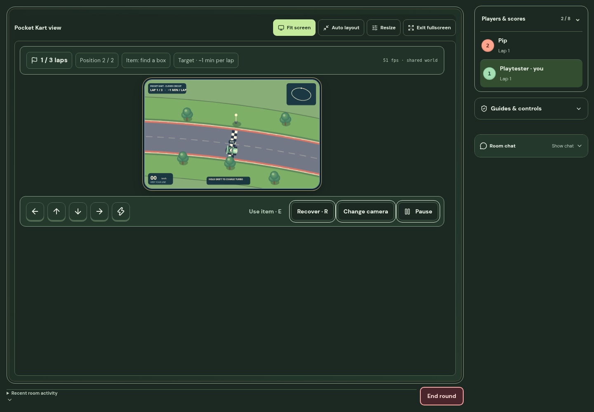
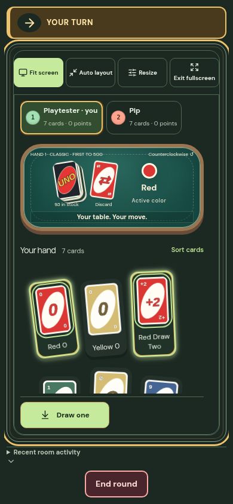
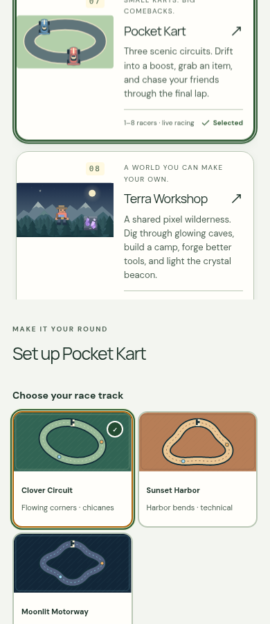

# Live play and stable game views — v12

Date: 1 November 2026 (Asia/Singapore).

## What changed

- Dedicated Durable Objects negotiate WebSocket state, private exact-base deltas and action receipts. The same server rule engine validates HTTP and WebSocket actions. Foreground action simulation runs at 50 ms steps.
- Each stream has at most four unacknowledged state frames. Once the player acknowledges a slot, the service sends the newest committed state rather than accumulating old movement updates. Invalid future acknowledgements cannot free slots.
- Opening and silent-connection timeouts, heartbeat recovery, bounded reconnects, missing-base recovery and session-generation cancellation address stalled streams and late responses from previous sessions. HTTP and older revision-only connections remain compatible. Large Drawing Relay artwork continues over HTTPS with live revision notifications.
- Game status is in normal layout flow. The turn-arrival notice is inside that status area. Neither follows scrolling over the board. Fullscreen fits the scene after reserving space for tools and controls, then restores the previous layout on exit. Redundant live-play banners and sizing readouts collapse in fullscreen; turn decisions and pause status remain available.
- UNO keeps Draw/penalty/Wild controls outside the scrolling private hand; large Flip hands and decision states have separate layouts. Guides and rule sources are in the sidebar toggle. Detailed scene tips and card edition notes are collapsed separately.
- Reconciliation uses finite recovery thresholds. Marble rolling integrates distance instead of multiplying absolute time by changing speed. Block movement eases visually without changing grid collision cells or acknowledgements. Its desktop/phone layout uses the container width, preventing a fitted canvas from changing its own aspect ratio. Cameras initialize to the controlled/watched actor.
- Forms, inventory, blur and visibility handling release held controls. The second local human’s touch controls use the human-seat order, including rooms with bots.
- Terra caches visible terrain chunks (at most twelve) and radial light stamps. Unchanged terrain is reused; mining redraws its changed chunk, and late artwork replaces fallback tiles.
- Map cards render the playable track/cover geometry. Phone cards use two columns. Documentation tabs and game setup panels fit a 320 px viewport. Static Pages and hosted builds import the same current arcade styles.

## Verification

All measurements below are local. The frontend used Vite and Chromium 154.0.8037.57; the server used local Wrangler/Durable Objects. Node was 24.19.0.

| Check | Result |
| --- | --- |
| TypeScript | `tsc --noEmit` passed |
| Complete game/room test suite | 370 passed, 0 failed, including historical Drawing Relay suites |
| Production frontend/Worker build | passed |
| Static Pages build | passed; the existing large, lazy reference-data chunk still produces a size warning |
| Dedicated Worker dry run | passed (761.55 KiB bundled, 164.71 KiB gzip); production deployment is pending |
| Casual game layout | 17 online modes at 1440 × 1000 and 390 × 844; no horizontal page overflow, page errors or status/canvas overlap |
| Real keyboard controls | Snake, sumo, tanks, paddles, marble, blocks, kart and Terra: intended movement direction; held inputs returned to neutral; another human seat received no controls |
| Silent connection | Dropped incoming live callbacks without closing the socket; heartbeat recovery created a fresh live channel |
| Private room state | Two human seats received their own projections; no token hashes in replies |
| Coding rooms | Code Sprint, Stack Survival and Quiz Cards started over the stream and pushed separate player projections |
| Slow-client stream | Four unacknowledged frames maximum; invalid future ACK ignored; next ACK released the latest committed revision |
| Website sections | Overview, learning paths, documentation, practice, playground, coding games, arcade and achievements checked at desktop, phone and 320 px widths |
| UNO edge cases | Large Flip hand, Wild color selection and penalty decisions checked in phone fullscreen |
| Terrain cache | Identical snapshots reuse paint; one mined chunk redraws; newly loaded art invalidates fallback tiles |

Browser action acknowledgement samples include the script’s 40 ms observation polling, so they are not sub-millisecond network benchmarks. Idle pool intentionally paints less often. Background/offscreen canvases suspend painting. Short FPS samples under local load do not certify performance on every phone, browser or connection.

The installed local runtime supports compatibility dates through 22 May 2026. Local Worker execution used that CLI override; the production configuration remains 31 October 2026. The source was also bundled with the production configuration. Safari, Firefox, physical phones and a geographically distributed production match were not tested.

## Evidence

- [All-game browser receipts](live-play-v12/game-layouts.json)
- [Final fullscreen controls](live-play-v12/fullscreen-layouts.json)
- [Website and map-card layouts](live-play-v12/website-layouts.json)
- [Keyboard movement and release checks](live-play-v12/keyboard-input.json)
- [Coding room checks](live-play-v12/coding-rooms.json)
- [Slow-client queue check](live-play-v12/slow-client.json)
- [UNO decision checks](live-play-v12/uno-decisions.json)

## Deployment and transport limits

These changes have not been deployed to Cloudflare. This task’s environment has no Cloudflare credential binding or outbound Cloudflare identity. The existing account, Durable Object classes, migrations, database ID and Site project identity are preserved. Deploy the dedicated Worker and the matching frontend to activate direct state/control streaming. Feature negotiation keeps old clients and older servers on their compatible HTTP/revision path during rollout.

Browsers and this Worker service do not expose raw UDP sockets. This release uses encrypted WebSockets and HTTPS. UDP-based WebRTC/WebTransport would require additional supported signaling/relay or server infrastructure. Reliable streams still have head-of-line blocking during packet loss; bounded queues, prediction and recovery reduce its impact without promising zero latency.
