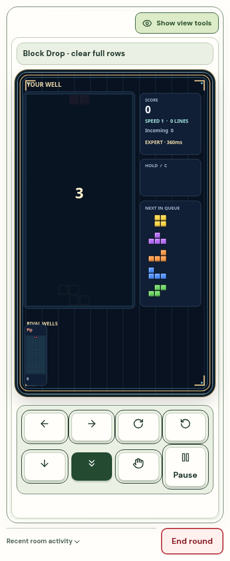
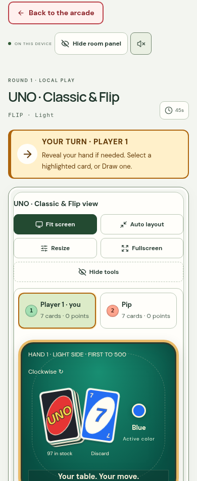

# Multiplayer motion and usable game views

1 November 2026. This release incorporates the two new GitHub pull requests and completes the live room/frontend publication. The merged checkpoint was pushed to `main` as `a1cb198` before further changes.

The live room connection carries private state, exact-base deltas and validated action receipts. Fresh continuous inputs can pass delayed receipts through eight bounded socket slots; HTTP fallback keeps two. Browser state adoption coalesces to one update per animation frame. Actual ping round trips feed the latency display. Inactive tabs and closed sockets release their held controls, while another active connection for the same seat keeps ownership.

Kart, tank, marble and Sumo presentation no longer pulls a moving player backward to correct an ordinary receipt. Remote actors retain a useful interpolation buffer on slower links. Snake carries a short head trail across missing updates and schedules turns ahead of their delivery, avoiding corner rewinds. Prediction and recovery remain bounded.

Sumo prediction cannot advance the tournament. The server owns every bracket transition, and a player whose duel has ended automatically watches an active duel while waiting. Seeded complete AI tournaments were checked through their final champions.

Auto layout is the initial view. Website navigation, room panels and view tools have separate Hide/Show controls. Hiding the room panel frees its grid column. Explicit Fit screen scales the scene without clipping the controls inside a fixed-height container. Fullscreen can hide its tools and restores the prior layout on exit. Guides remain collapsed until opened.

The merged website artwork, larger library cards, buttons and bright tank shells are retained. UNO uses readable straight card rows; large hands scroll within their own collection while decisions remain outside it. New pool tables use 14-unit balls, 40% larger than before, with matching rack spacing, collision footprints, aim guides and bot shots. Existing pool tables keep their stored/original radius. Moonlit Harbor adds a fourth arena with its own cover and marble route; collision and painting use the same cached geometry.

Terra's mechanics, terrain renderer and `drawTerra` function match their pre-change hashes. Shared ActionWorld edits are conditional on kart racing. [Preservation checks](live-play-v14/preserved-terra.json).

## Validation

| Check | Result |
| --- | --- |
| TypeScript | passed |
| Full test suite | **389 passed**, 0 failed |
| Game layouts | 17 modes × desktop and phone; no page errors, horizontal overflow or status/board overlap |
| Website | 8 sections × 1440, 390 and 320 px; no page errors or horizontal overflow |
| View controls | desktop and phone; website/panel/tools hide and restore, Fit clipping, fullscreen, Auto layout restoration and focus |
| UNO decisions | 40-card Flip hands and four Wild-color choices; desktop and phone fullscreen |
| Live sockets | 8 human seats, private projections, valid actions, slow receiver coalescing, rejected future ACK, inactive/disconnect release |
| Real delayed transport | two Chromium clients per mode; ordered WebSocket/HTTP proxy at 400 ms RTT with ±80 ms jitter |
| Forced HTTP fallback | two tank clients with WebSockets disabled; control receipts applied and no reverse correction |
| Complete AI tournaments | seeded 3- and 8-seat Sumo brackets reached one champion and moved in every round |
| Compatibility assets | all 95 immutable assets from the published v12 archive retained, with dependency/integrity checks |

The delayed socket run recorded no reverse frames while holding a direction in kart, tanks, marble, Sumo, Snake or Block Drop. Action receipts were 343–481 ms at the median for each mode under that proxy. Snake's planned turn response was 310 ms; local prediction does not make an inherently delayed turn authoritative sooner. Block Drop tracing records discrete piece cells; its paint easing is separate. These are local controlled measurements, not geographic production benchmarks.

The eight-seat local socket run delivered 19 state frames to each seat during a 1.16 s sample, with a 17 ms median action receipt. That sample included full action responses and used about 64–65 KB/s per seat. It is an integration/load check, not a capacity guarantee.

Production publication uses `pnpm run build`, `pnpm run build:pages` and a minified dedicated Worker dry run from the pushed commit. The existing Site identity, public audience, D1 database and Durable Object namespaces are preserved. The separate full-site Worker is not replaced by the arcade API bundle.

## Evidence

- [Game layouts](live-play-v14/game-layouts.json), [website layouts](live-play-v14/website.json), [view controls](live-play-v14/view-controls.json)
- [Delayed movement](live-play-v14/movement.json), [eight-seat and privacy checks](live-play-v14/sockets.json), [HTTP fallback](live-play-v14/http-fallback.json)
- [UNO decision fixtures](live-play-v14/uno-decisions.json)

Local execution used Chromium and Wrangler's local Durable Object runtime. The installed runtime requires a 22 May 2026 compatibility-date override locally; production stays on 31 October 2026. Physical phones, Safari/Firefox and matches between geographically separated players were not measured. Real packet loss and multi-second Internet round trips can still delay a reliable stream; this release does not promise zero latency.
